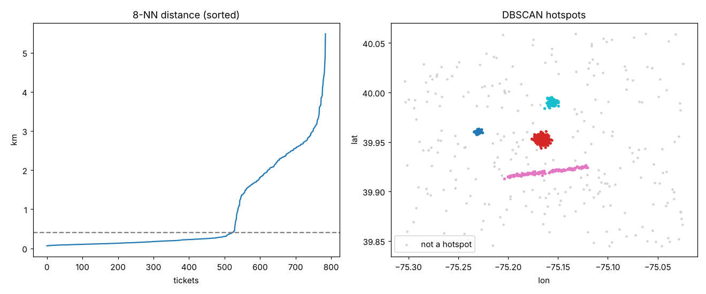

# dbscan-geospatial-hotspots

Finds clusters of service-outage tickets on a map with DBSCAN, using real distances (haversine on lat/lon)
so `eps` is set in kilometres. It picks `eps` from the k-distance curve, summarises each hotspot, and compares
the result with k-means and with badly chosen `eps` values.



## Data

Synthetic tickets around Philadelphia (785 total), so the right answer is known:

| Planted group | Tickets | Shape |
|---|---|---|
| center_city | 220 | round, ~0.35 km spread |
| north_philly | 120 | round, ~0.25 km |
| west_small | 45 | small and tight |
| cable_corridor | 140 | long thin line (~7 km), like a damaged cable along a road |
| noise | 260 | scattered over ~25 × 25 km |

Real tickets would carry a geocoded service address. The pipeline only needs `lat` and `lon` columns.

## Method

1. Compute each ticket's distance to its 8th nearest neighbour (BallTree, haversine), sort, and take the knee
   of that curve as `eps`. Here that gives **0.41 km**.
2. Run DBSCAN with `eps = km / earth radius` and `min_samples = 8`. Label `-1` means "not part of a hotspot".
3. Summarise each hotspot: ticket count, centroid, p90 radius and span (bounding-box diagonal).

## Results (`python -m hotspots`)

| Method | Clusters | ARI vs truth | Noise kept out | Hotspot tickets dropped |
|---|---|---|---|---|
| **DBSCAN, eps 0.41 km (knee)** | 4 | **0.969** | 97.3% | 1 |
| DBSCAN, eps 0.15 km | 7 | 0.511 | 99.6% | 161 |
| DBSCAN, eps 1.50 km | 5 | 0.477 | 66.9% | 0 |
| k-means, k=4 | 4 | 0.347 | 0% | 0 |
| k-means, k=5 | 5 | 0.353 | 0% | 0 |

- All four planted hotspots come back as separate clusters. The 140 corridor tickets land in a single cluster,
  and only 7 of 260 background tickets get pulled into a hotspot.
- k-means has no notion of noise, so every scattered ticket is forced into some cluster.
- If `eps` is too small, real hotspots break into fragments and 161 hotspot tickets get labelled as noise. If
  it is too large, nearby background tickets get absorbed.

Hotspot summary:

| Tickets | Centroid | p90 radius | Span |
|---|---|---|---|
| 222 | 39.9524, -75.1658 | 0.69 km | 2.56 km |
| 144 | 39.9196, -75.1628 | 3.22 km | 7.27 km |
| 120 | 39.9900, -75.1558 | 0.47 km | 1.72 km |
| 45 | 39.9600, -75.2299 | 0.32 km | 0.97 km |

The corridor's centroid sits in the middle of a line, and its "radius" doesn't describe it well. That's why
the summary also reports the span.

## Stability across seeds

Across seeds 1–10, the knee gave eps values between 0.34 and 0.43 km and ARI between 0.91 and 0.977. In 9 of
the 10 seeds DBSCAN found exactly 4 hotspots. In seed 1 a gap in the corridor split it into two clusters
(62 + 78 tickets). That's a known DBSCAN behaviour with uneven density along a line.

## Run

```bash
pip install -r requirements.txt
PYTHONPATH=src python -m hotspots            # prints tables, writes docs/hotspots.png
pytest -q
```
